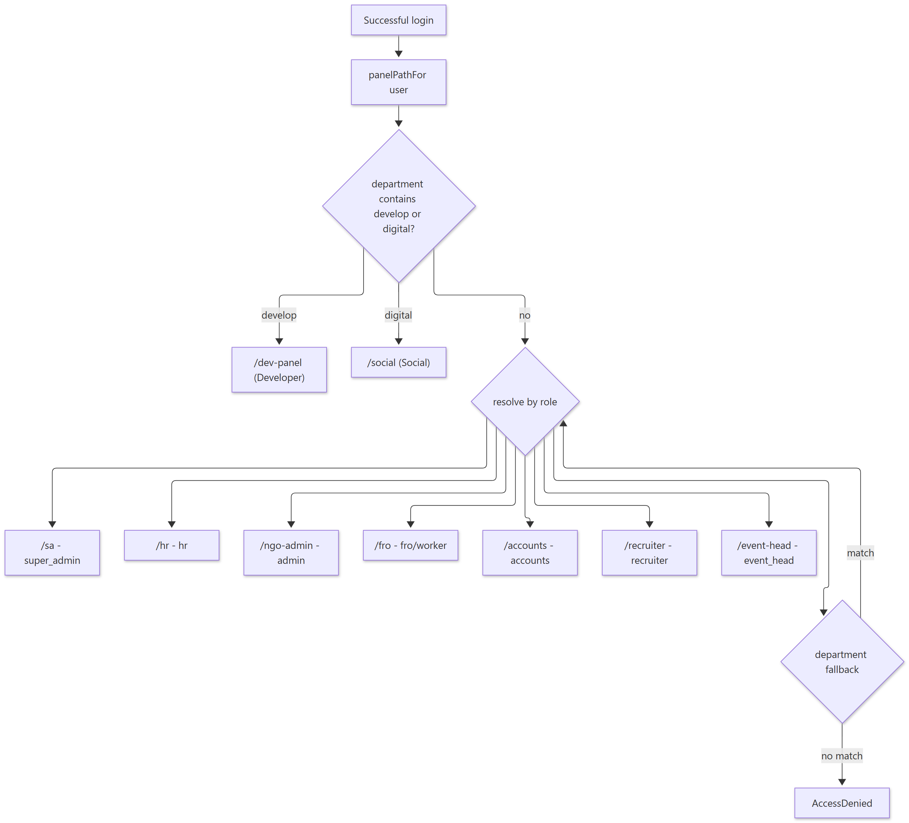
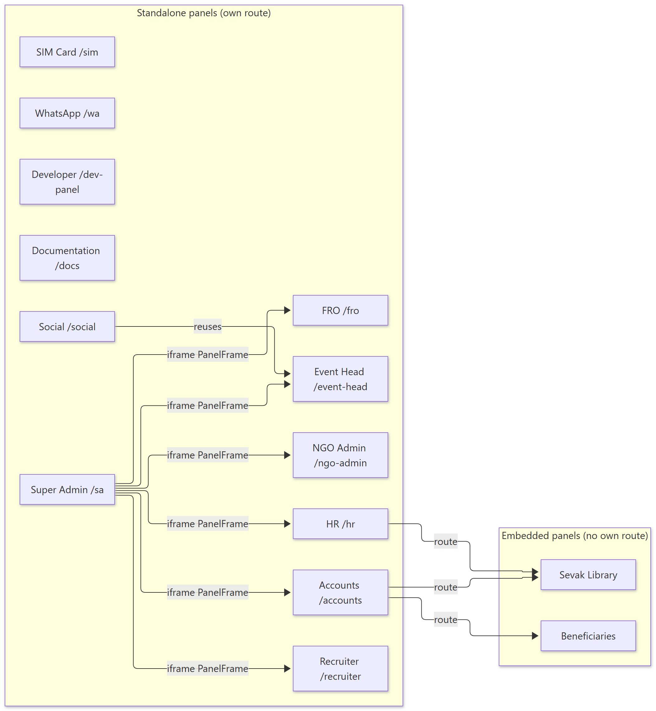
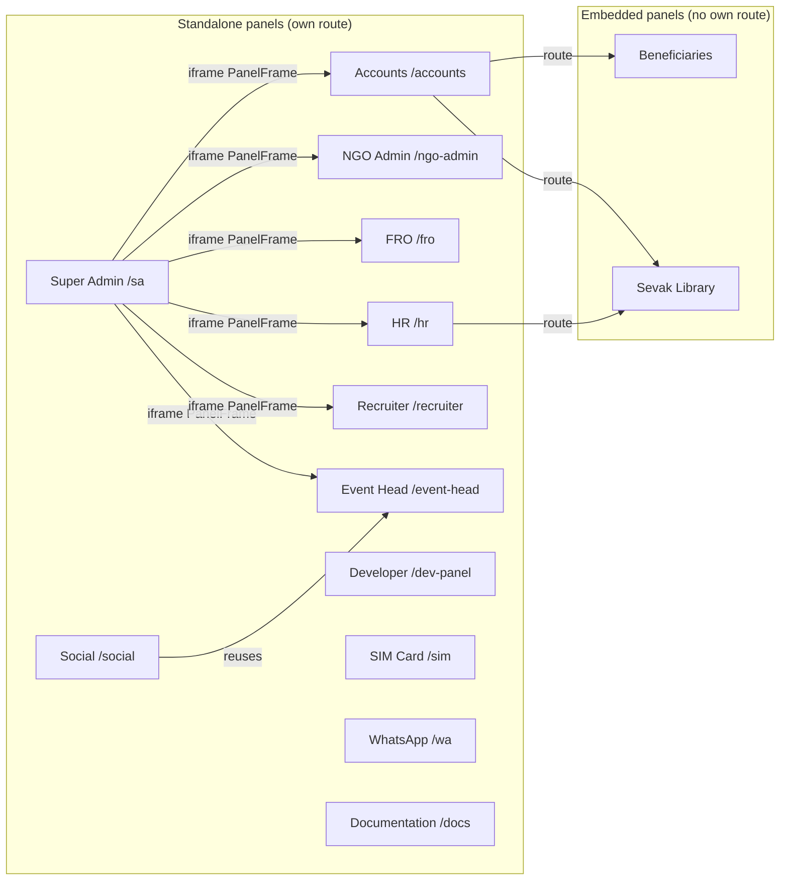

# UCS CRM — Panel Navigation Map

> **Document ID:** 02-System-Architecture/PANEL-NAVIGATION
> **Status:** Verified
> **Generated:** 2026-10-13
> **Related:** [SYSTEM-ARCHITECTURE](SYSTEM-ARCHITECTURE.md) · [Panel Documentation](../03-Panel-Documentation/)

## 1. Purpose

Show how a logged-in user is routed to a panel and how panels relate to each other, based on `client/src/App.jsx`.

---

## 2. Routing Decision


<details><summary>Show diagram source (Mermaid)</summary>

```mermaid
flowchart TB
    LOGIN[Successful login] --> PP[panelPathFor user]
    PP --> DEPT{department contains develop or digital?}
    DEPT -->|develop| DEV["/dev-panel (Developer)"]
    DEPT -->|digital| SOC["/social (Social)"]hiii
    DEPT -->|no| ROLE{resolve by role}
    ROLE --> SA["/sa - super_admin"]
    ROLE --> HR["/hr - hr"]
    ROLE --> NGO["/ngo-admin - admin"]
    ROLE --> FRO["/fro - fro/worker"]
    ROLE --> ACC["/accounts - accounts"]
    ROLE --> REC["/recruiter - recruiter"]
    ROLE --> EVH["/event-head - event_head"]
    ROLE --> OTHER{department fallback}
    OTHER -->|match| ROLE
    OTHER -->|no match| DENY[AccessDenied]
```

</details>


**Explanation.** `panelPathFor()` is role-first; department is consulted only to split `digital` (→ `/social`) from `develop*` (→ `/dev-panel`). This ordering was deliberately changed so an accounts worker (department "Admin", role "accounts") lands on `/accounts`, not `/ngo-admin`.

**Source:** `client/src/App.jsx` lines 28–61 (`ROLE_PATHS`, `ROLE_PANELS`) and 139–163 (`panelPathFor`).

---

## 3. Panel Relationship Map


<details><summary>Show diagram source (Mermaid)</summary>



</details>


**Explanation.** Super Admin embeds other panels read-only through `PanelFrame` iframes (config in `panels/super-admin/embedPanels.js`). `beneficiaries` and `sevak-library` are mounted inside `accounts` (and `sevak-library` also inside `hr`). `social` reuses the event-head `ActivityPlanner` and `ChatWorkspace`.

**Source references:** `client/src/panels/super-admin/SuperAdminPanel.jsx`, `client/src/panels/super-admin/embedPanels.js`, `client/src/panels/accounts/AccountsPanel.jsx`, `client/src/panels/hr/HRPanel.jsx`.

---

## 4. Cross-Panel Shared Components

| Component | Location | Used by |
| --- | --- | --- |
| `ChatWorkspace` | `client/src/components/chat/` | every panel's `/chat` route |
| `NoticesBar`, `NoticePopupHost` | `client/src/components/` | mounted per panel wrapper |
| `TicketPopupHost` | `client/src/components/TicketPopupHost.jsx` | per panel wrapper |
| `TechnicalTickets` | `client/src/components/TechnicalTickets.jsx` | dev, ngo-admin, recruiter, event-head |
| `DailyReport` | `client/src/components/DailyReport/` | hr, social, recruiter, dev |
| `SpecialIncentive`, `LeadIncentive` | `client/src/components/` | accounts, super-admin |
| `SimSection` | `client/src/panels/accounts/sim/` | accounts |
| `FroIdleReportPanel` | `client/src/components/froIdleReport/` | super-admin, ngo-admin |

---

## 5. Verification

All route bases and role lists above are read directly from `client/src/App.jsx`. Panel-internal sub-routes are enumerated in each panel's documentation under `docs/03-Panel-Documentation/`.
