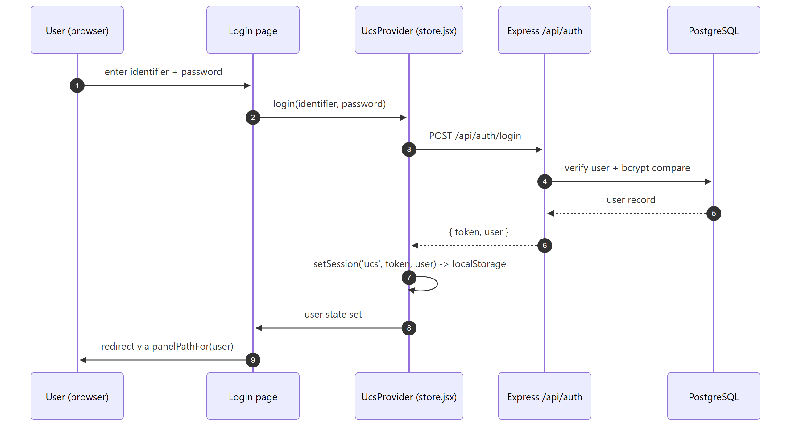
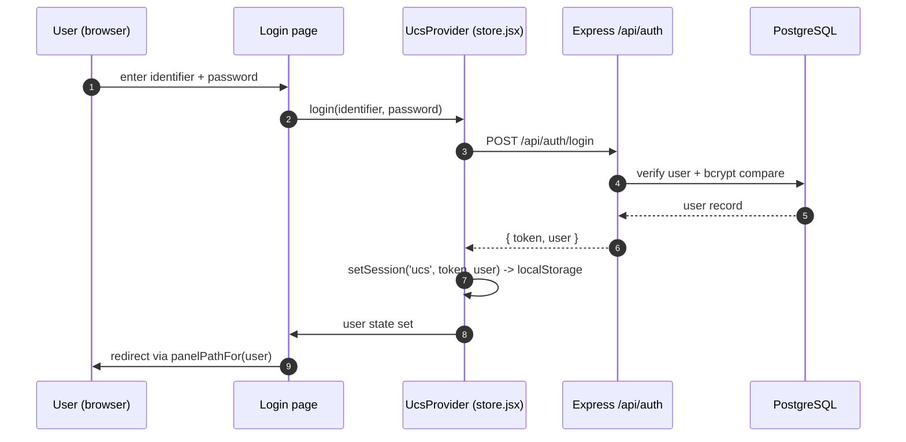
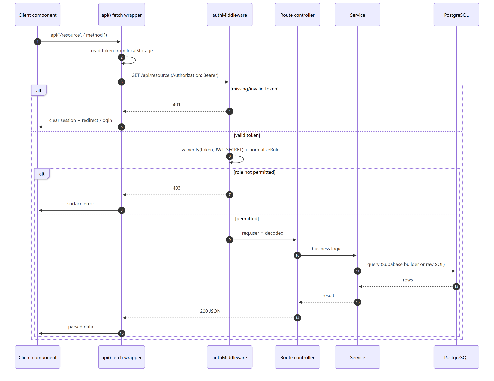
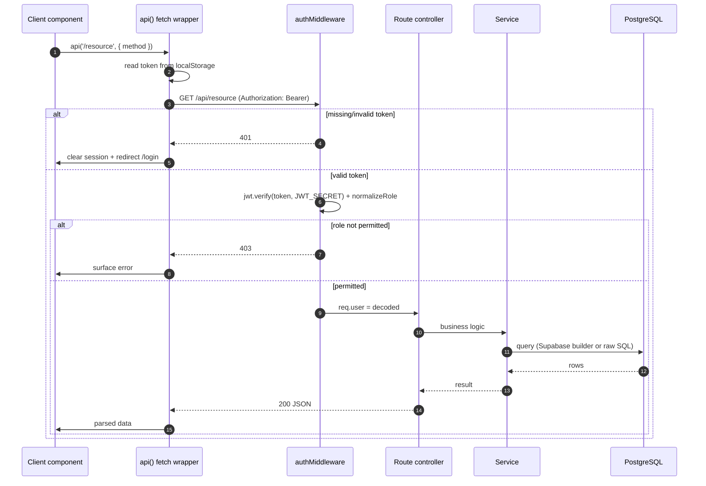
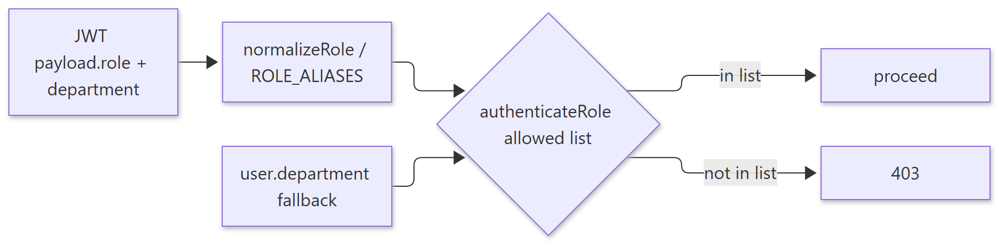
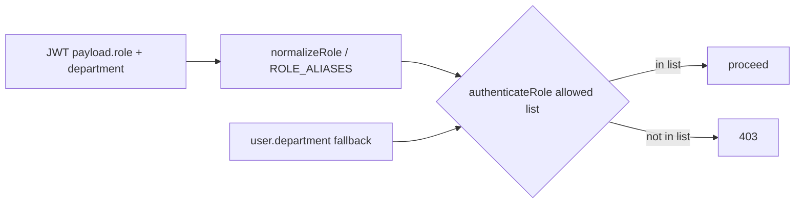
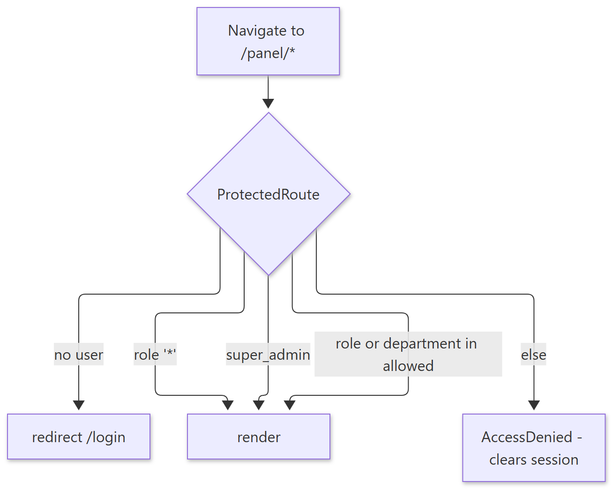
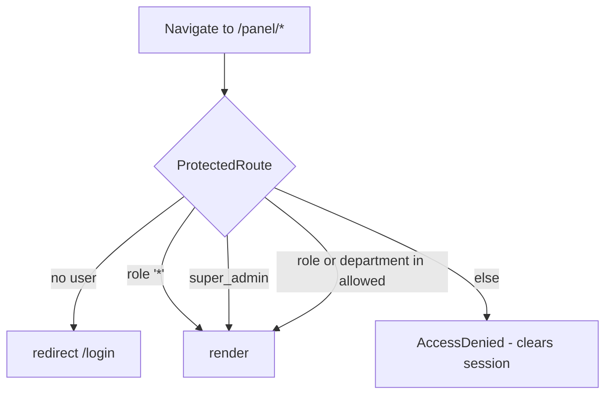
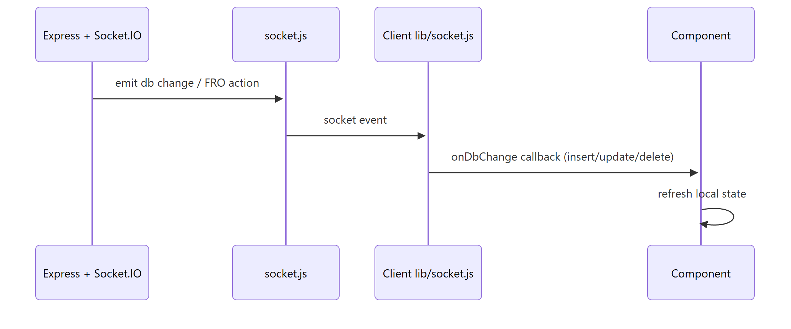
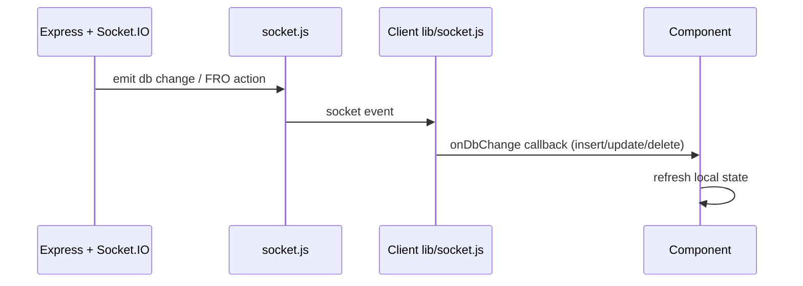

# UCS CRM — Request & Authentication Flow

> **Document ID:** 02-System-Architecture/REQUEST-FLOW
> **Status:** Verified (auth code paths) / Partially verified (per-route gates)
> **Generated:** 2026-10-13
> **Related:** [SYSTEM-ARCHITECTURE](SYSTEM-ARCHITECTURE.md) · [PANEL-NAVIGATION](PANEL-NAVIGATION.md)

## 1. Purpose

Trace how a browser action becomes an authenticated API request and how the backend authorizes and serves it.

---

## 2. Authentication Flow (login)

Show diagram source (Mermaid)

**Source references:** `client/src/store.jsx` (`login`, `setSession`), `client/src/api/auth.js` (`login`, `setSession`), `backend/src/controllers/authController.js`, `backend/src/middleware/authMiddleware.js`.

**Note.** Login route itself is public by necessity; every other route is expected to require a valid bearer token.

---

## 3. Authenticated Request Flow

Show diagram source (Mermaid)

**Source references:** `client/src/api/auth.js` (401 handling), `backend/src/middleware/authMiddleware.js` (`authenticate`, `authenticateRole`, `normalizeRole`).

---

## 4. Authorization Model

Show diagram source (Mermaid)

- Canonical roles and aliases: `backend/src/middleware/authMiddleware.js` (`ROLE_ALIASES`, `normalizeRole`).
- Predefined guards: `authenticateAdmin`, `authenticateWorker`, `authenticateSalary`, `authenticateAccountsOrEventTeam`.
- Department is used as a fallback for event-team scope to mirror the client (`isEventTeam`).

---

## 5. Client-Side Route Guard Flow

Show diagram source (Mermaid)

**Source references:** `client/src/App.jsx` (`ProtectedRoute`, `panelPathFor`, `ROLE_PANELS`).

---

## 6. Realtime Event Flow

Show diagram source (Mermaid)

**Source references:** `backend/src/socket.js`, `client/src/lib/socket.js` (`onDbChange`, `onFroAction`, `onSocketConnect`).

---

## 7. Unverified Items

- Per-route auth gates: not every one of the ~86 mounts was individually inspected. Each route's gate must be confirmed during Phase 4 (API reference). Status: **Partially verified**.
