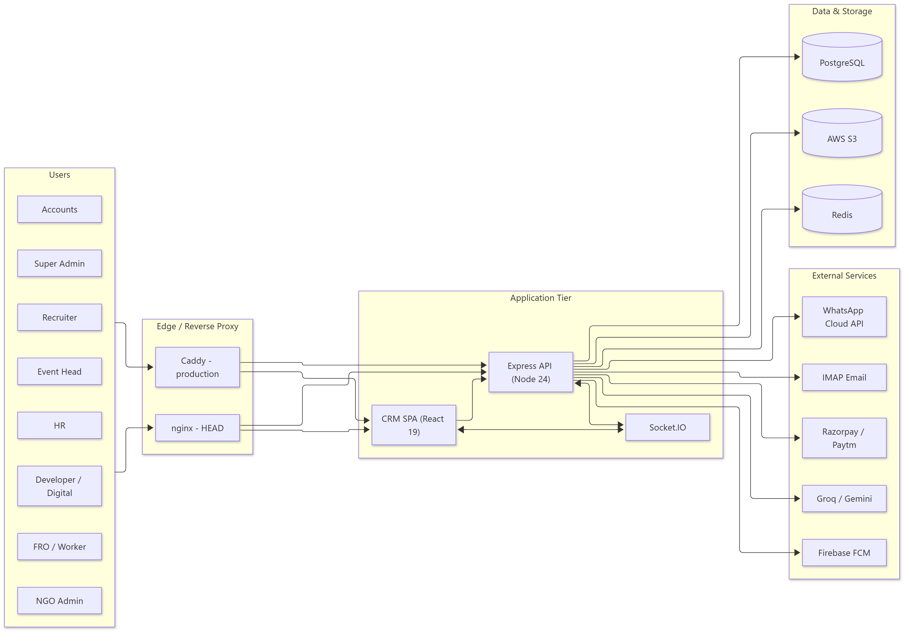
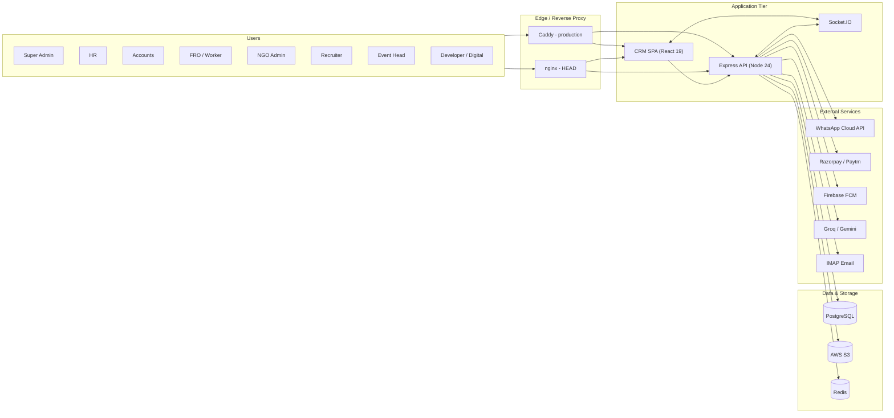
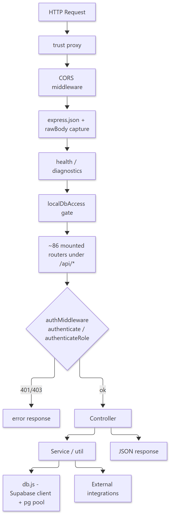
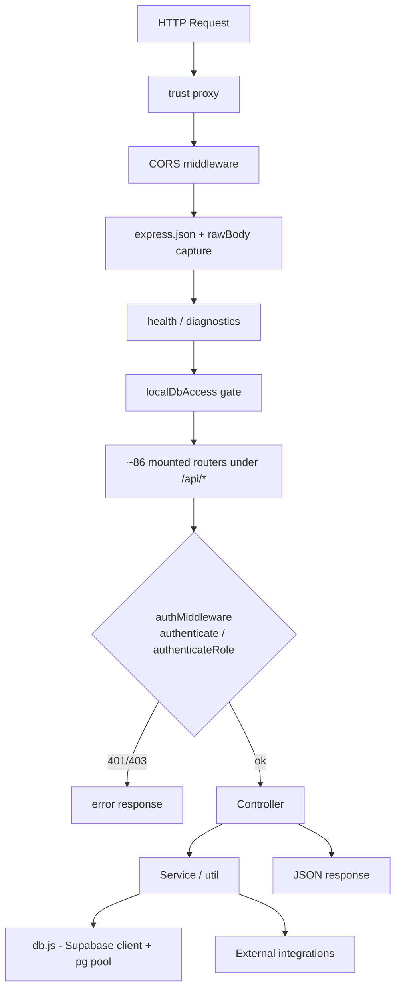
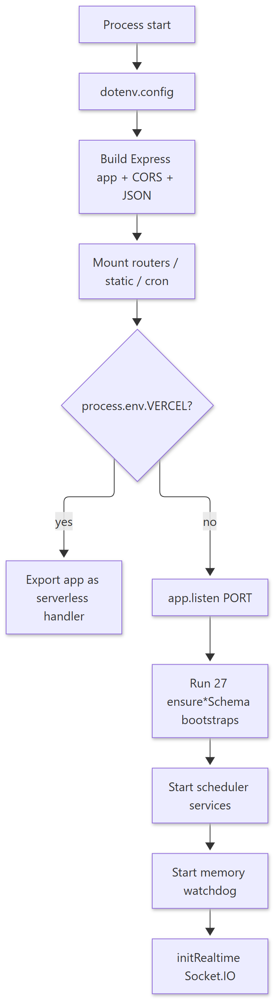
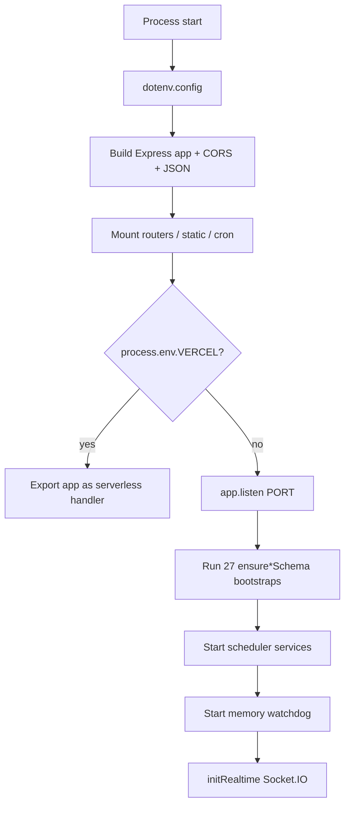

# UCS CRM — System Architecture

> **Document ID:** 02-System-Architecture/SYSTEM-ARCHITECTURE
> **Status:** Verified (mounts, stack, data stores) / Partially verified (deployment topology details)
> **Generated:** 2026-10-13
> **Related:** [PROJECT-INVENTORY](../00-Project-Overview/PROJECT-INVENTORY.md) · [REQUEST-FLOW](REQUEST-FLOW.md) · [PANEL-NAVIGATION](PANEL-NAVIGATION.md)

## 1. Purpose

This document describes the high-level architecture of the primary UCS CRM system: the browser client, the Express API, the PostgreSQL database, realtime transport, scheduled jobs, and external integrations. It is derived from `backend/src/index.js`, `backend/src/config/db.js`, `backend/src/socket.js`, and `client/src/App.jsx`.

---

## 2. Context Diagram

Show diagram source (Mermaid)

**Figures:** Context diagram — how actors, edge, application, data, and external services relate.

**Explanation.** Browser clients are served as static bundles through the reverse proxy; all dynamic behavior goes to the Express API under `/api/*`. Realtime events flow over Socket.IO between the browser and the API process. PostgreSQL is the system of record; S3 holds uploaded media/receipts; Redis supports caching/queues. External integrations are server-side only.

**Source references:** `backend/src/index.js` (CORS, mounts, static SPA hosts), `backend/src/config/db.js`, `backend/src/socket.js`, `infra/caddy/Caddyfile`, `infra/nginx/head.conf`.

---

## 3. Application Tier (Backend)

Show diagram source (Mermaid)

**Explanation.** Middleware ordering matters: CORS and JSON parsing run before route handling; the `localDbAccess` gate is mounted at `/api`; each router then applies its own JWT auth guard via `authMiddleware`. Controllers delegate to services/utilities that touch the database or external systems.

**Source references:** `backend/src/index.js` (middleware chain, lines ~154–218), `backend/src/middleware/authMiddleware.js`.

### 3.1 Startup sequence

Show diagram source (Mermaid)

**Source references:** `backend/src/index.js` (bootstraps lines ~1185–1224, schedulers ~1213–1221, socket ~1226).

### 3.2 Scheduled jobs

| Scheduler | File |
| --- | --- |
| Notification scheduler | `backend/src/services/notificationScheduler.js` |
| FRO auto-logout | `backend/src/services/froAutoLogoutScheduler.js` |
| DB health watchdog | `backend/src/services/dbHealthWatchdog.js` |
| Reminder notifications | `backend/src/services/reminderNotificationScheduler.js` |
| FRO monthly rollover | `backend/src/services/froMonthlyRollover.js` |
| FRO idle reconcile | `backend/src/services/froIdleReconcileScheduler.js` |
| Memory watchdog | `backend/src/services/memoryWatchdog.js` |

Cron HTTP endpoints (protected by `CRON_API_KEY`): `/api/cron/notifications`, `/api/cron/email-import`, `/api/cron/razorpay-sync`, `/api/cron/db-health`, `/api/cron/fro-auto-logout`, `/api/cron/fro-month-rollover`, `/api/cron/fro-idle-reconcile`, `/api/cron/sevak-renewals` (`backend/src/index.js` ~1047–1141).

---

## 4. Client Tier (Frontend)

| Concern | Implementation | Source |
| --- | --- | --- |
| App shell & routing | React Router v7, `BrowserRouter` in `main.jsx`; route table in `App.jsx` | `client/src/App.jsx` |
| Panel loading | Each panel code-split with `React.lazy` | `client/src/App.jsx` lines 15–26 |
| Global auth state | `UcsProvider` (`user`, `token`, `login`, `logout`) | `client/src/store.jsx` |
| HTTP client | `fetch` wrapper with bearer token, 120s timeout, 401 auto-logout | `client/src/api/auth.js` |
| API base | `VITE_API_URL` | `client/src/lib/apiBase.js` |
| Realtime | socket.io-client singleton + `onDbChange` helper | `client/src/lib/socket.js` |
| Error isolation | `ErrorBoundary` around the tree | `client/src/App.jsx` lines 181–205 |

---

## 5. Data Architecture

| Store | Role | Evidence |
| --- | --- | --- |
| PostgreSQL | System of record for all business entities | `backend/src/config/db.js`, 91 models |
| Supabase client | Query builder used for most app reads/writes over the same PostgreSQL | `backend/src/config/db.js` |
| Raw `pg` pool | Direct SQL for dev tools and hot paths | `db._pool` in `backend/src/index.js` |
| AWS S3 | Uploaded media, receipts, signatures | `backend/src/services/s3Browser.js`, presign helpers |
| Redis | Cache / short-lived state | `backend/src/config/redis.cjs` |

Detailed table-by-table dictionary and ER diagrams are in `docs/05-Database-Documentation/` (Phase 4).

---

## 6. Security Boundaries

- **Public edge:** reverse proxy terminates TLS (production) and injects security headers (`infra/caddy/Caddyfile`).
- **API trust boundary:** every `/api/*` route is expected to declare an auth gate; the existing `docs/security/` set flags this as a recurring risk area.
- **Client-side role checks are not a security control** — they only control rendering; the backend re-enforces roles via `authMiddleware`. This is stated explicitly in `client/src/components/chat/chatIdentity.js` (per `docs/security/README.md`).

See `docs/10-Security/` and the existing `docs/security/` set for the full analysis. **No secrets are recorded in this documentation set.**

---

## 7. Known Architectural Constraints (Verified)

1. **Bootstrap-enforced schema** — there is no single migration chain; schema is ensured at boot by 27 functions, so schema drift risk exists.
2. **Mixed DB access styles** — Supabase query builder and raw SQL coexist, so SQL style is not uniform.
3. **CORS is `origin: '*'`** in `backend/src/index.js` (line ~154) — permissive; noted in the security set.
4. **Vercel mode** disables `app.listen` and Socket.IO (`process.env.VERCEL`), so realtime is not available on the serverless deployment path.
