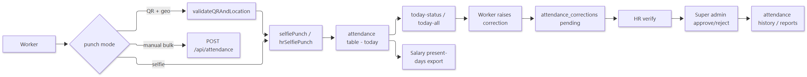
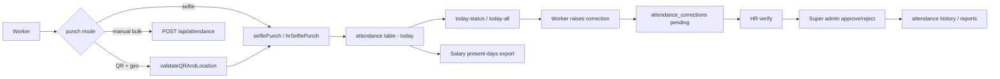

# Workflow — Attendance Lifecycle

> **Document ID:** 04-Module-Workflows/WF-ATTENDANCE
> **Status:** Partially verified (endpoints + helpers verified; exact geo validation read at util level)
> **Generated:** 2026-10-13
> **Related:** HR panel doc · `backend/src/controllers/attendanceController.js`, `qrController.js`, `utils/geo.js`

## 1. Purpose
Workers punch in/out (or use selfie punch), HR manages the records, and corrections flow through verify → approve.

## 2. Flow

Show diagram source (Mermaid)

## 3. Key endpoints

| Action | Endpoint | Notes |
| --- | --- | --- |
| Punch in | `POST /api/attendance/punch-in` | `authenticate` |
| Punch out | `POST /api/attendance/punch-out` | `authenticate` |
| Selfie punch | `POST /api/attendance/selfie-punch` | `authenticate` |
| QR validate | `POST /api/qr/validate` | `authenticateWorker` + geo |
| Corrections | `POST /api/attendance-corrections` | raises ticket |
| Verify correction | `PUT /api/attendance-corrections/:id/verify` | HR/admin |
| Approve correction | `PUT /api/attendance-corrections/:id/approve` | super_admin |
| Present days | `GET /api/salary/present-days` | `authenticateSalary` |

## 4. Business rules

- Geo/QR validation happens server-side in `geo.js`/`qrController.js` (verified util level).
- Attendance feeds `salary present-days` export and `attendanceReportDocx.js` (payer export downloadable from salary route).
- Corrections are immutable after approval (state machine in `attendanceCorrectionModel`).

## 5. Related workflows
- Payroll: `WF-PAYROLL.md`
- FRO time: `WF-FRO-TIME.md`