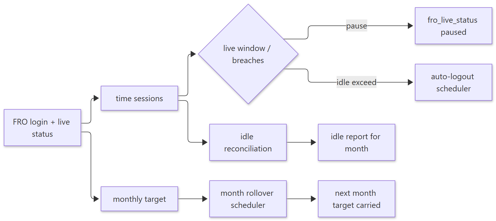
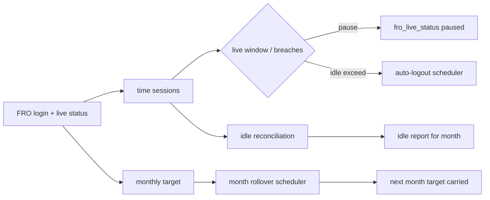

# Workflow — FRO Live Status, Idle, Cover & Rollover

> **Document ID:** 04-Module-Workflows/WF-FRO-TIME
> **Status:** Partially verified (services listed and traced at function level; arithmetic details in FRO panel marked Partial)
> **Generated:** 2026-10-13
> **Related:** FRO panel doc · `backend/src/services/froLiveWindow.js`, `froTimeSessions.js`, `froIdle.js`, `froIdleReconcileScheduler.js`, `froMonthlyRollover.js`

## 1. Purpose
Track an FRO's live window, compute idle pauses/coverage, auto-logout inactive FROs, and roll over monthly goals.

## 2. Flow

Show diagram source (Mermaid)

## 3. Schedulers and cron entry points

| Scheduler | File | Cron/route |
| --- | --- | --- |
| FRO auto-logout | `froAutoLogoutScheduler.js` | `/api/cron/fro-auto-logout` |
| FRO idle reconcile | `froIdleReconcileScheduler.js` | `/api/cron/fro-idle-reconcile` |
| FRO month rollover | `froMonthlyRollover.js` | `/api/cron/fro-month-rollover` |

## 4. Main FRO endpoints

| Action | Endpoint | Notes |
| --- | --- | --- |
| Live status | `GET/PUT /api/fro/status` | self/admin |
| Logout all | `POST /api/fro/status/logout-all` | admin |
| Time event | `POST /api/fro/status/time-event` | applies window math |
| Idle report | `GET /api/fro/reports/idle/me` · `/api/fro/reports/idle` | self/admin |
| My target | `GET /api/fro/target` | self |

## 5. Business rules observed

- Idle reconciliation writes committed idle minutes used in reports and dashboard (`froIdleCommit.js`, `froIdle.js`).
- Cover-freeze logic pauses cover attribution during idle (`froCoverFreeze.js`).
- Monthly targets are auto-generated (`froAutoTarget.js`) and rolled over.

## 6. Verification to-do
- Confirm exact window/idle arithmetic from `froLiveWindow.js` / `froTimeSessions.js` (marked Partially verified in FRO panel).