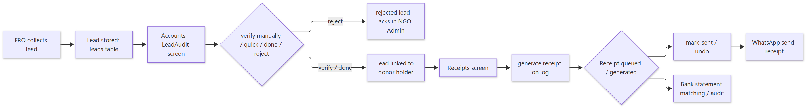
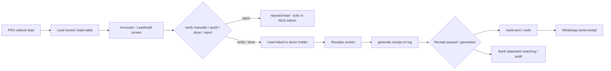

# Workflow — Lead → Verification → Receipt

> **Document ID:** 04-Module-Workflows/WF-LEAD-RECEIPT
> **Status:** Partially verified (flow read; some controller internals abbreviated)
> **Generated:** 2026-10-13
> **Related:** Accounts panel doc · FRO panel doc · `backend/src/controllers/accountsController.js`

## 1. Purpose
A donor lead collected by an FRO/telecaller is verified on the Accounts panel and, once value is collected, a receipt is generated. This is the money core of the CRM.

## 2. Flow

Show diagram source (Mermaid)

## 3. Key backend entry points

| Action | Endpoint | Controller fn |
| --- | --- | --- |
| Verify | `POST /api/accounts/leads/:logId/verify` | `accountsController.verifyLead` |
| Quick verify | `POST /api/accounts/leads/:logId/quick-verify` | `quickVerifyLead` |
| Done | `POST /api/accounts/leads/:logId/done` | `doneLead` |
| Reject | `POST /api/accounts/leads/:logId/reject` | `rejectLead` |
| Receipt | `POST /api/accounts/leads/:logId/receipt` | `generateReceipt` |
| List receipts | `GET /api/accounts/receipts` | `getReceiptList` |

## 4. Business rules seen in the flow

- Verification is credit-based: credits awarded encode who gets the donor (FRO/team). Source: `leads.js` util + Accounts `Business Logic` section.
- Receipt generation is idempotent per log (`generateReceipt` guard) — Accounts panel doc.
- Bank audit auto-match (`autoMatchService.js`) links receipt entries to bank statement lines.

## 5. Databases touched
`leads`, `donor_profiles`, `receipts`, `rejected_lead_tickets`, `payment_webhook_log` (for gateway matched receipts), `receipt_claims`, `suspense_donations`.