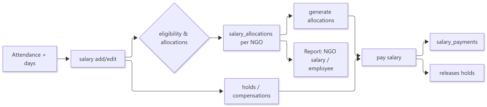
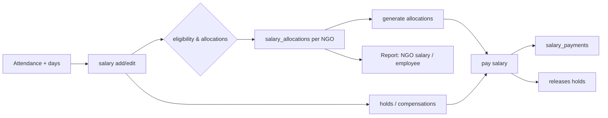

# Workflow — Salary, NGO Allocation & Pay

> **Document ID:** 04-Module-Workflows/WF-PAYROLL
> **Status:** Partially verified (route/auth verified; salary math read from `salaryDays.js` util + panel docs)
> **Generated:** 2026-10-13
> **Related:** Accounts panel doc · HR panel doc · `backend/src/controllers/salaryController.js`, `ngoAllocationController.js`

## 1. Purpose
Compute monthly salary for workers, allocate the cost across NGOs, handle holds/compensations, and produce payroll exports (pagar).

## 2. Flow

Show diagram source (Mermaid)

## 3. Key endpoints

| Action | Endpoint | Auth |
| --- | --- | --- |
| List / add salary | `GET/POST /api/salary` | `adminHrAccounts` |
| Edit / delete | `PUT/DELETE /api/salary/:id` | `adminHrAccounts` |
| Pay | `PUT /api/salary/:id/pay` | `adminOrHrOrHo` |
| Hold set/release | `PUT /api/salary/hold`, `DELETE /api/salary/hold/:workerId` | `adminHrAccounts` |
| Compensations | `PUT /api/salary/compensations` | `accounts` |
| Present-days export | `GET /api/salary/present-days` | `authenticateSalary` |
| Pagar export | `GET /api/salary/pagar-export` | `adminHrAccounts` |
| NGO allocations | `GET/PUT /api/ngo-allocations/workers/:id/salary` | `adminHrAccounts` |

## 4. Business rules

- Salary logic centrepiece helpers: `salaryDays.js`, `salaryModel.js`, `salary_history`.
- Salary access is privacy-gated via a 4-digit access code (`/api/salary/access-code/status` etc.) and client `SalaryPrivacyContext`.
- Worker people allocations & NGO splitting through `worker_people_allocations`, `worker_ngo_allocations`.

## 5. Related workflows
- `WF-ATTENDANCE.md` (feeds present days)
- `WF-LEAD-RECEIPT.md` (receipts, unrelated but Accounts-adjacent)