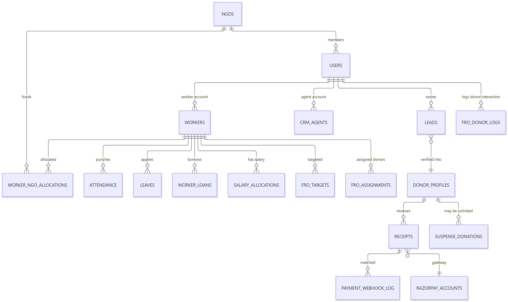
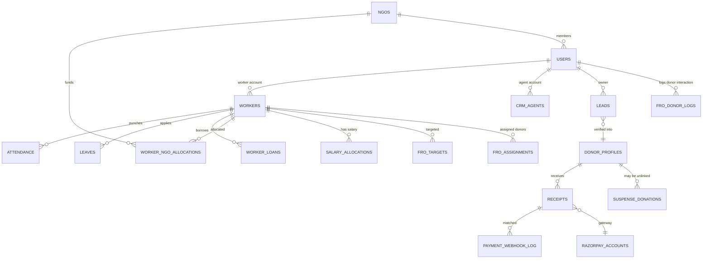
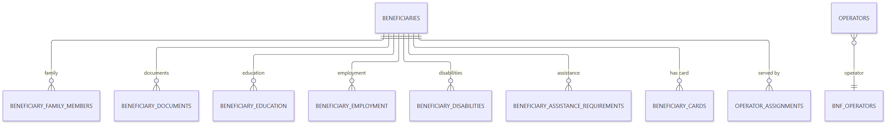
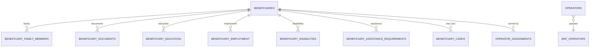
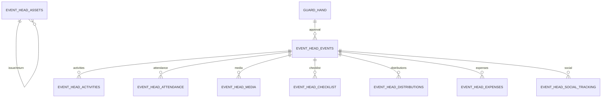
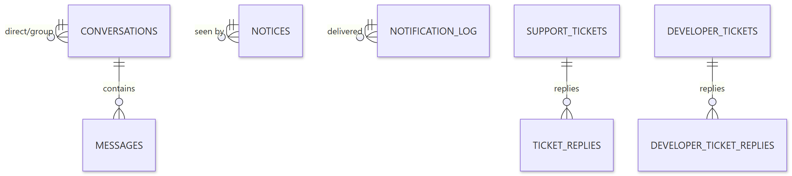
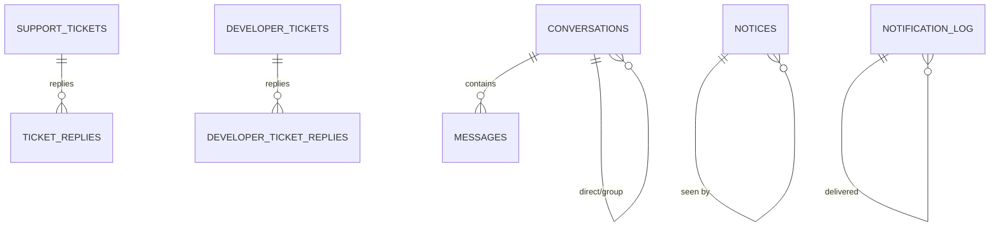

# UCS CRM — Entity Relationship Overview

> **Document ID:** 05-Database-Documentation/ER-DIAGRAM
> **Status:** Partially verified — entity names are read from code; cardinalities below are **inferred from naming conventions and key names** unless a bootstrap FK was confirmed.
> **Generated:** 2026-10-13
> **Cross-reference:** [DATA-DICTIONARY](DATA-DICTIONARY.md) · [MODELS-INDEX](MODELS-INDEX.md) · `backend/src/bootstrap/ensure*.js` (column/FK truth)

## 1. Core CRM Entities

Show diagram source (Mermaid)

**Explanation.** `workers`/`crm_agents` are the operational personnel; `leads` become `donor_profiles` on verification and then generate `receipts`. FRO workflows revolve around `fro_assignments`, `fro_donor_logs`, `fro_targets`. NGO allocations tie worker salaries to funding NGOs. Confirm each FK in the matching `ensure*Schema.js` bootstrap.

**Sources:** table names from `backend/src/**` `.from()` references; cardinalities from naming (`_id` suffixes) — **inferred**.

## 2. Beneficiary Domain

Show diagram source (Mermaid)

**Explanation.** A beneficiary aggregates sub-records (family, documents, education, employment, disability, assistance) each keyed by beneficiary id. Operators/`bnf_operators` handle daily events and distributions (`benefit_distributions`, `benefit_distribution_items`).

## 3. Event Head Domain

Show diagram source (Mermaid)

**Explanation.** The event-head module is a self-contained project system: events carry activities, volunteers, assets, materials, media, checklist, expenses and social-tracking records; events pass an approval workflow before completion.

## 4. Communication Domain

Show diagram source (Mermaid)

## 5. References

- Model files `backend/src/models/*.js` (see [MODELS-INDEX](MODELS-INDEX.md))
- Schema guarantees `backend/src/bootstrap/ensure*.js` — these are authoritative for columns and FKs
- Legacy SQL migrations: `backend/migrations/`, `backend/src/migrations/`

## 6. Verification to-do

- [ ] Confirm FK constraints in each `ensure*Schema.js` (column-level; **Partially verified**)
- [ ] Verify `receipts.log_id ↔ leads` linkage (controller-level, confirmed for receipt flow in Accounts docs)
- [ ] Verify `fro_assignments/lead_assignments` split