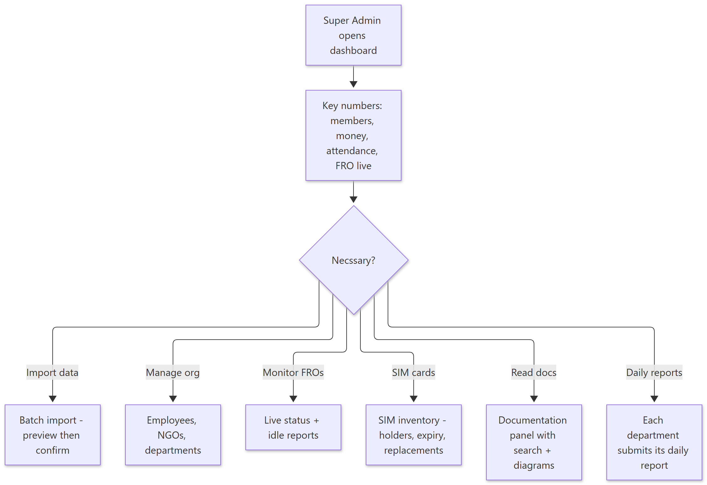
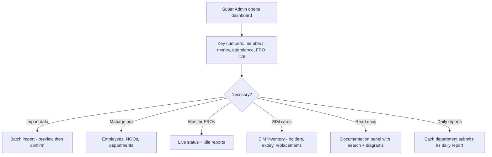

# How Admin Tools Work — Simple Guide

> **Document ID:** 16-Plain-English/HOW-ADMIN-TOOLS-WORK
> **Status:** Verified
> **Related:** [Super Admin Panel](../03-Panel-Documentation/Super-Admin/PANEL.md) · [SIM Card Panel](../03-Panel-Documentation/SIM-Card/PANEL.md) · [Documentation Panel](../03-Panel-Documentation/Documentation/PANEL.md)

## 1. The story in one paragraph

The boss' side of the CRM has powerful **dashboards** (one view of the whole NGO, plus daily reports per department) and **organisation tools**: employee records, departments/NGOs, data import, notices, tickets, incentives, live FRO status and idle reports. There are also two special areas: the **SIM card inventory** (who holds which SIM, expiring dates) and the **in-app documentation** panel (these documents with search and diagrams).

## 2. Step-by-step (plain English)

**Dashboards**
1. Open Super Admin → the dashboard shows key counts (members, donations, attendance, FRO live status).
2. Department heads open **daily reports** (e.g. HR daily, Social daily, Recruiter daily) and submit/update their day's numbers.

**Organisation data**
1. Employees/NGO/departments are managed in the organisation screens.
2. **Data import** lets admin upload donor/employee data in batches — each batch is inspected and confirmed before it enters the system.

**SIM Card inventory**
1. The SIM panel lists stock, who has which number, and which SIMs are about to expire.
2. Replacements and history are logged; import/settings help keep the list current.

**Documentation panel**
1. Open the `Documentation` panel (`/docs`) — it shows these documents with search and rendered diagrams, so staff can read them without leaving the app.

## 3. Simple flowchart

Show diagram source (Mermaid)

## 4. Important rules to remember

- Dashboards are **server-side totals**, not screenshots — they read the real tables.
- **Batch import is safe**: nothing lands in the database until admin *confirms* after *preview*.
- The **SIM panel** is embedded inside Accounts (`/accounts`) and also reachable separately — keep the two in sync (they share one backend database).
- The documentation panel in the app is a **view of the same content** described here.

## 5. Key words

| Word | Meaning |
| --- | --- |
| Dashboard | The summary screen of numbers |
| Daily report | One department's day-end numbers |
| Batch import | Uploading many rows that must be confirmed |
| SIM inventory | Record of SIM cards, holders, expiry |
| Documentation panel | In-app viewer of these documents |

---
**Do not skip:** [Start Here](START-HERE.md) — this guide completes the simple tour of the system.