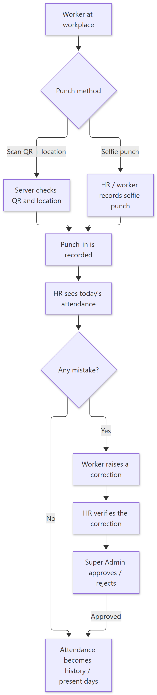
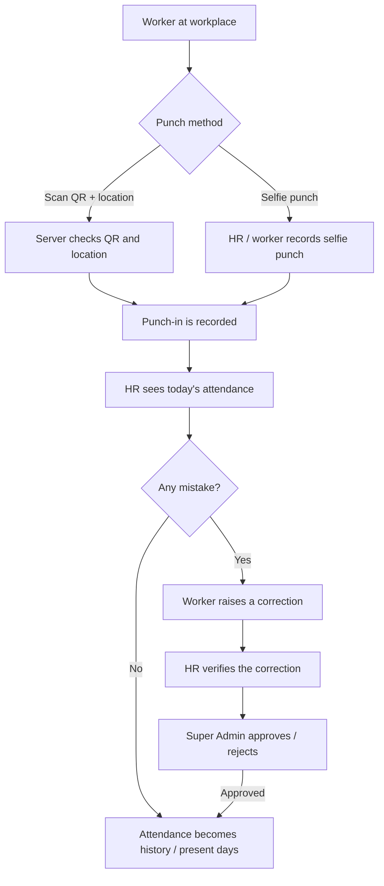

# How Attendance Works — Simple Guide

> **Document ID:** 16-Plain-English/HOW-ATTENDANCE-WORK
> **Status:** Verified
> **Related:** [HR Panel](../03-Panel-Documentation/HR/PANEL.md) · [Technical workflow](../04-Module-Workflows/WF-ATTENDANCE.md)

## 1. The story in one paragraph

A worker comes to work and **punches in** (using a QR code at the location, or by **taking a selfie**). When the day ends, they **punch out**. HR can see *today's punch list* for everyone. If a punch is wrong (forgot to punch, wrong time), the worker **raises a correction**. HR checks the correction first, and the **Super Admin approves** it before it is final. Correct attendance becomes the **"present days"** number that payroll uses to calculate salary.

## 2. Step-by-step (plain English)

1. **Punch in** — worker scans the QR at the workplace (the system also checks the phone's location) or uses the selfie option. This is recorded as *holiday* or *in today's attendance*.
2. **Work day passes** — HR can open the today page and see who is in, at what time.
3. **Punch out** — worker ends the shift. Both punches together make one attendance record.
4. **HR reviews** — HR sees today's list and can verify any record manually.
5. **(Optional) Correction** — if a worker's punch was wrong they raise a correction; HR verifies it; Super Admin approves it; only then is the final attendance changed.
6. **Salary uses it** — payroll reads the corrected attendance as **present days**.

## 3. Simple flowchart

Show diagram source (Mermaid)

## 4. Important rules to remember

- Punch-in is **not only a button** — the server checks the QR **and** the location, so people cannot punch from home.
- Corrections are **two-step**: HR verifies, Super Admin approves. Neither one can do it alone.
- Salary's **present days** and attendance reports use the **corrected** attendance, not the first punch entered.
- Workers/HR roles with salary access must also enter a private **access code** to see salary-related pages.

## 5. Key words

| Word | Meaning |
| --- | --- |
| Punch in / out | Start and end of the working day |
| Selfie punch | Punch with a self-photo proof |
| QR + location check | Server verifies a code and the phone position |
| Today status | Who punched in so far, right now |
| Correction | A request to fix a wrong attendance record |
| Present days | Count of working days used to calculate salary |

---
**Do not skip:** [How Payroll Works](HOW-PAYROLL-WORKS.md) — attendance feeds salary.