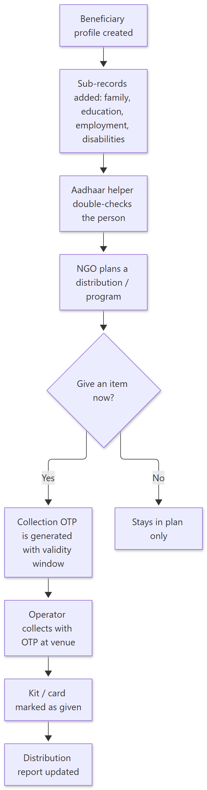
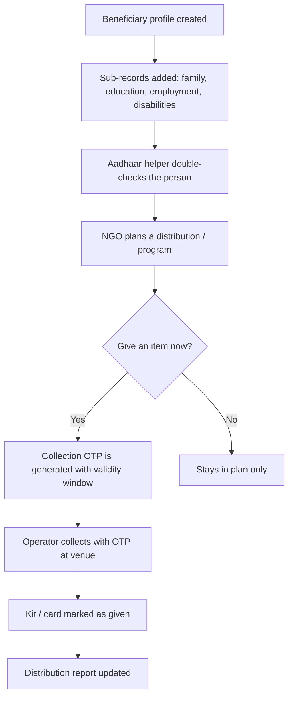

# How Beneficiaries Work — Simple Guide

> **Document ID:** 16-Plain-English/HOW-BENEFICIARIES-WORK
> **Status:** Verified
> **Related:** [Embedded Beneficiaries Panel](../03-Panel-Documentation/Embedded-Beneficiaries/PANEL.md) · [FRO Panel](../03-Panel-Documentation/FRO/PANEL.md)

## 1. The story in one paragraph

A **beneficiary** is a family/person the NGO supports. The system keeps a full **profile** for each beneficiary: family members, education, employment, disabilities, and the help they need. When the NGO wants to give a **kit**, the operator first raises a **collection OTP** — a one-time code that proves the right person is collecting at the right time. Daily **distributions** and **programs** are recorded so the NGO can prove what was given and to whom.

## 2. Step-by-step (plain English)

1. **Add a beneficiary** — the profile is created (often imported in a batch and then inspected before being confirmed).
2. **Add sub-records** — family members, documents, education, employment, disabilities, assistance requirements are attached to the profile.
3. **Read the Aadhaar card** — the system can double-check details using an Aadhaar reader (one-time code, never stored in risky places).
4. **Plan a distribution** — an event/operator selects beneficiaries and the items (kit, ration, etc.).
5. **Collection OTP** — to give an item, an OTP is created for that beneficiary; the system enforces the validity window (currently about one month) before the code expires.
6. **Mark the card** — the kit/card state is updated so the same item is not given twice.

## 3. Simple flowchart

Show diagram source (Mermaid)

## 4. Important rules to remember

- The **OTP has a time limit** — the code cannot be used forever; the window is enforced in the server code (currently roughly one month).
- **Nothing is given twice** by mistake — the beneficiary card state is updated.
- Batch import is done in a safe order: **load → preview → confirm**, so junk data never jumps straight into the database.
- The beneficiary screens are **embedded** inside the Accounts panel (and reachable from other admin panels) — they are not a separate website.

## 5. Key words

| Word | Meaning |
| --- | --- |
| Beneficiary | A family/person the NGO supports |
| Sub-record | One part of the profile (education, family, etc.) |
| Aadhaar helper | A tool that reads and verifies Aadhaar details |
| Distribution | Giving items/help to beneficiaries |
| Collection OTP | One-time code to collect help |
| Kit / card | The items given and its completion status |

---
**Do not skip:** [How Events Work](HOW-EVENTS-WORK.md) — many distributions happen during events.