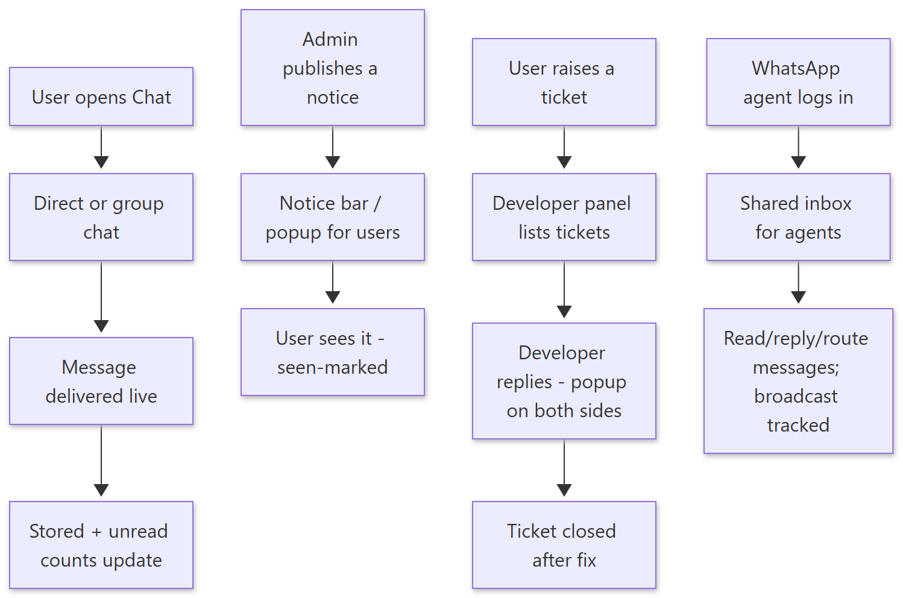
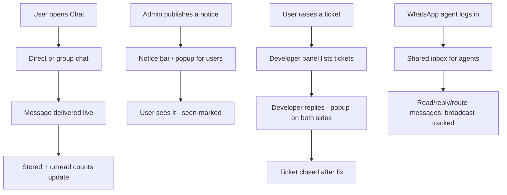

# How Communication Works — Simple Guide

> **Document ID:** 16-Plain-English/HOW-COMMUNICATION-WORKS
> **Status:** Verified
> **Related:** most panels share these components · [WhatsApp Panel](../03-Panel-Documentation/WhatsApp/PANEL.md) · [Developer Panel](../03-Panel-Documentation/Developer/PANEL.md)

## 1. The story in one paragraph

Inside the system people talk to each other with **chat** (private and group messages, live), read official **notices** (shown as a bar or popup), and raise **tickets** when something is broken or needs a developer. There is also a **WhatsApp inbox** for the team assigned to WhatsApp, and the system can push mobile notifications.

## 2. Step-by-step (plain English)

**Chat**
1. Open Chat (present in most panels). Create/join a **direct** or **group** chat.
2. Send a message; it is delivered live via the realtime connection.
3. Chat rooms, members, messages are stored; unread counts show where attention is needed.

**Notices**
1. Admin publishes a **notice** (title, message, audience).
2. Users see it in the top bar and/or as a popup. The system remembers you have seen it.

**Tickets**
1. Anyone raises a **support ticket** describing the problem.
2. Developers pick tickets from the Developer panel (`/dev-panel`) — my/all/unassigned lists — reply, fix, and close.
3. Popups appear for new/replied tickets so nobody misses them.

**WhatsApp**
1. The WhatsApp panel shows the team's shared **inbox**.
2. Agents (people assigned to WhatsApp) can read, reply, route messages, and the system tracks outbound/broadcast messages.

## 3. Simple flowchart

Show diagram source (Mermaid)

## 4. Important rules to remember

- **Tickets are visible where they are handled** — the Developer panel has my/all/unassigned views, and support tickets are handled by the assigned team.
- Notices and tickets use **popups + seen-state** stored on the server so the same notice does not nag forever.
- Chat is **realtime** in the browser app when connected; if the server runs in a special mode (e.g. Vercel) realtime features that depend on a long-running socket may be unavailable — the digital team decides deployment accordingly.
- WhatsApp features depend on agents being **assigned**; an agent only sees what they are allowed to see.

## 5. Key words

| Word | Meaning |
| --- | --- |
| Realtime | Messages appear instantly without refresh |
| Notice | Official message shown to users |
| Ticket | A request/issue logged for a team or developer |
| Popup | A small window that opens to catch attention |
| WhatsApp agent | A person assigned to handle WhatsApp messages |
| Broadcast | A message sent to many people at once |

---
**Do not skip:** [How Admin Tools Work](HOW-ADMIN-TOOLS-WORK.md) — admins publish notices and watch tickets.