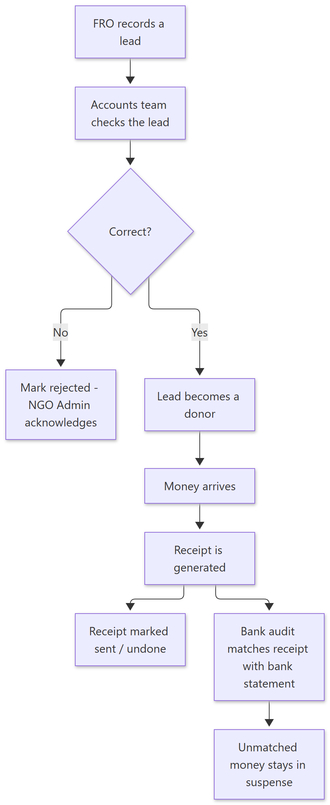
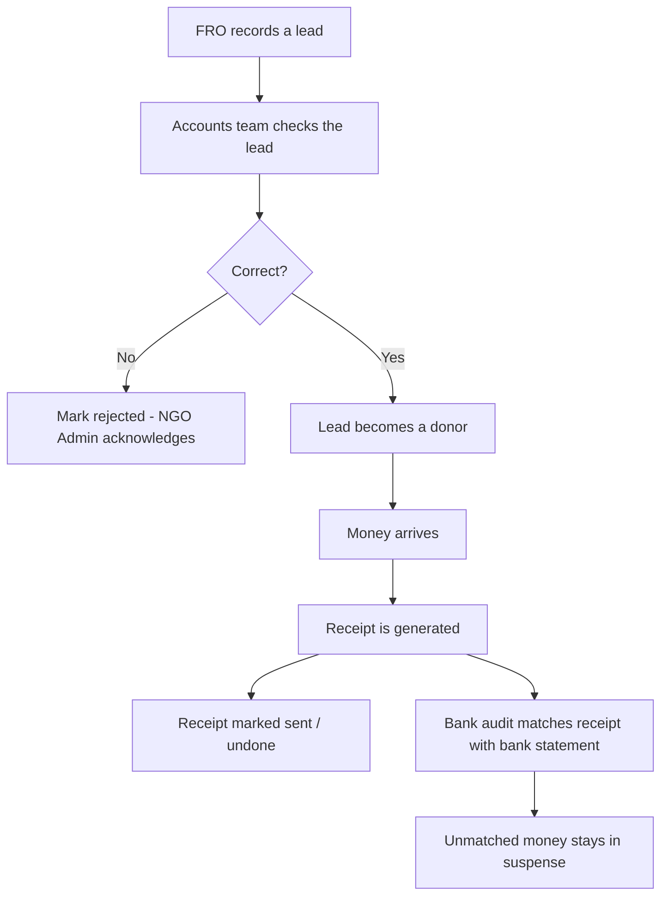

# How Donations & Receipts Work — Simple Guide

> **Document ID:** 16-Plain-English/HOW-DONATIONS-WORK
> **Status:** Verified (concise story of the Accounts/FRO flow)
> **Related:** [Accounts Panel](../03-Panel-Documentation/Accounts/PANEL.md) · [FRO Panel](../03-Panel-Documentation/FRO/PANEL.md) · [Technical workflow](../04-Module-Workflows/WF-LEAD-RECEIPT.md)

## 1. The story in one paragraph

When a supporter shows interest in donating, the **FRO** (the person who talks to supporters) records the supporter's details in the CRM. This entry is called a **lead**. The **Accounts team** later checks that lead. If it is correct, the lead becomes a proper **donor**. When money actually arrives, Accounts creates a **receipt** — a proof of payment the donor keeps. At the end of the month, receipts are matched with the **bank statement**, and any payment that cannot be linked to a donor is kept in a "**suspense**" list until it is solved.

## 2. Step-by-step (plain English)

1. **FRO records the lead** — name, phone, amount expected, notes (screen: FRO → Leads).
2. **Accounts reviews it** — the Accounts team can *verify* (accept), *quick verify*, mark *done*, or *reject* (screen: Accounts → Lead Audit).
3. **Donor is created** — a verified lead is linked to a donor profile; rejected leads appear in the NGO Admin panel for acknowledge.
4. **Money arrives** — by bank, gateway, or cash.
5. **Receipt is generated** — Accounts opens Receipts and generates a receipt for the donation (screen: Accounts → Receipts).
6. **Receipt is sent** — the receipt can be marked "sent" (e.g., over WhatsApp) or "undone" if the team made a mistake.
7. **Bank matching** — the Automated Bank Audit screen matches receipt entries against the real bank statement; matched rows are cleared, unmatched ones stay for manual handling.

## 3. Simple flowchart

Show diagram source (Mermaid)

## 4. Important rules to remember

- A lead is only a **promise**; the donor is created **after verification**.
- **One donation = one receipt**; the system prevents accidental double receipts (it is *idempotent* — clicking twice creates one receipt).
- If money does not match any donor, it goes to **suspense** — the team must solve it, it is never silently ignored.
- Who "wins" the donor (the FRO, the team, the home office) is decided by **credit rules** the Accounts admin configures — this affects incentives and incentives reports.

## 5. Key words

| Word | Meaning |
| --- | --- |
| Lead | A new possible supporter, before verification |
| Donor | A supporter who is verified |
| Receipt | Proof of money received |
| Suspense | Money received but not yet linked to a donor |
| Bank audit | Matching receipts with the real bank list |
| Rejected lead | A lead the Accounts team said no to |

---
**Do not skip:** [How Incentives Work](HOW-INCENTIVES-WORK.md) — because who gets credit for a donor decides incentives.