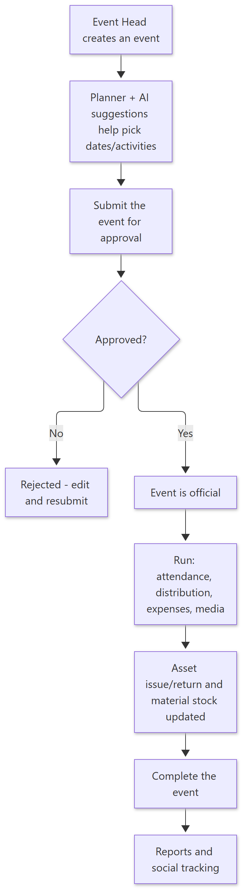
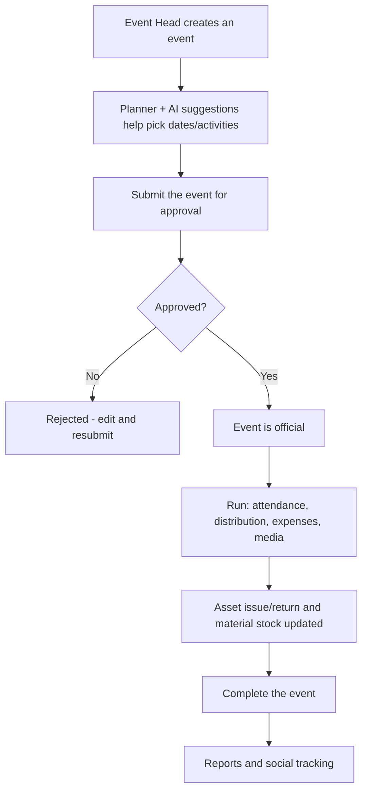

# How Events Work — Simple Guide

> **Document ID:** 16-Plain-English/HOW-EVENTS-WORK
> **Status:** Verified
> **Related:** [Event Head Panel](../03-Panel-Documentation/Event-Head/PANEL.md)

## 1. The story in one paragraph

The **Event Head / Manager** runs the NGO's programs — from a small activity to a big distribution. The panel has a **planner** (calendar with AI suggestions), a list of **events**, an **approval workflow** (an event must be submitted and approved before it is official), and special tracks for **assets, materials, volunteers, distribution, attendance, media and reports**. The social team reuses the same planner for its activities.

## 2. Step-by-step (plain English)

1. **Create an event** — event head adds the event with name, date, NGO, place.
2. **Fill details** — activities, checklist, materials, assets, volunteers, distribution plan, media.
3. **Submit for approval** — the event goes into *pending*. An approver accepts or rejects it. A rejected/submitted event is not "official".
4. **Run the event** — record **attendance**, **distribute** to beneficiaries, log **expenses**, issue and return **assets**, upload **media**.
5. **Complete** — the event head marks the event complete; the system stores the final **social tracking** proof.
6. **Reports** — monthly/event reports and export (e.g. reels PDF for social posts).

## 3. Simple flowchart

Show diagram source (Mermaid)

## 4. Important rules to remember

- **Nothing is official until approved.** Submit → approve/reject is enforced on the server, not just on the screen.
- **Assets and materials** are tracked like a store: issue, return, adjust stock — so nothing disappears silently.
- The **planner** uses real calendar/observance data and AI suggestions to propose activities and dates; suggestions can be accepted or ignored.
- Photos/media uploads are part of the event record and can be reused for social reports.

## 5. Key words

| Word | Meaning |
| --- | --- |
| Event | One program/activity of the NGO |
| Planner | Calendar view + AI date/activity suggestions |
| Approval workflow | Submit → approve/reject before official |
| Asset / material | rented or stored items used by events |
| Distribution | Giving help to beneficiaries during the event |
| Social tracking | Proof/post material saved for the social team |

---
**Do not skip:** [How Beneficiaries Work](HOW-BENEFICIARIES-WORK.md) — event distribution reaches beneficiaries.