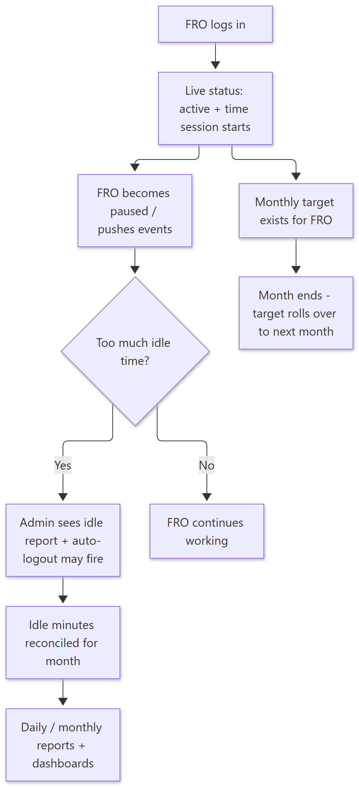
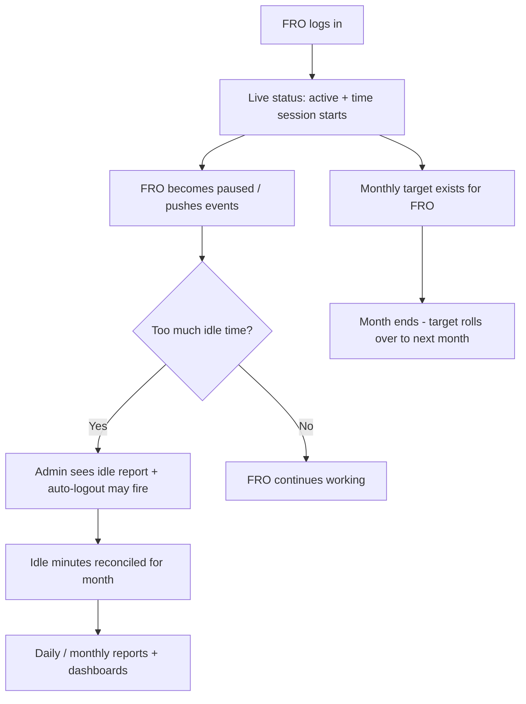

# How FRO Time & Work Tracking Works — Simple Guide

> **Document ID:** 16-Plain-English/HOW-FRO-TIME-WORKS
> **Status:** Verified
> **Related:** [FRO Panel](../03-Panel-Documentation/FRO/PANEL.md) · [Super Admin Panel](../03-Panel-Documentation/Super-Admin/PANEL.md) · [Technical workflow](../04-Module-Workflows/WF-FRO-TIME.md)

## 1. The story in one paragraph

FROs (the people who talk to donors) are expected to be **"live" (available and working)** during their shift. The system watches each FRO's **live status**. If someone is idle for too long, the system computes **idle minutes**, an admin sees an **idle report**, and the system can **auto-logout** a person who is not active. Monthly, each FRO also has a **target** (how many donations/amount), which is **rolled over** automatically into the next month.

## 2. Step-by-step (plain English)

1. **FRO starts** — logs into the FRO app; the system marks the person *live* (active) and starts a **time session**.
2. **Status changes** — the FRO can be *active*, *paused*, or *offline*. Each change is a **time event**.
3. **Idle watch** — the system tracks pauses and idle time against rules (home office/super admin can see live status for all FROs).
4. **Auto-logout** — if a person stays idle past the limit, an unattended scheduler logs them out.
5. **Monthly reconciliation** — an idle-reconcile job makes idle minutes consistent across reports, and a monthly rollover job creates the **next month's target** from the rules.

## 3. Simple flowchart

Show diagram source (Mermaid)

## 4. Important rules to remember

- "**Live**" does not mean logged in — it means *actively working* as far as the system can measure.
- **Idle time** is not guessed; it is written into the records by the *idle reconcile* job that runs on a schedule (and can be triggered by admins).
- **Auto-logout** protects the workflow — a person who is idle too long is logged out of their session automatically.
- **Monthly rollover** is automatic: next month's target is prepared even if nobody opens the screen.
- Idle work is counted with **cover** rules (who covers whose area), also visible in FRO reports.

## 5. Key words

| Word | Meaning |
| --- | --- |
| Live status | Is the FRO actively working right now |
| Time session | A period of work for one FRO |
| Idle minutes | Time the FRO was not active |
| Auto-logout | System logs out an idle FRO |
| Reconciliation | Making all reports agree on idle minutes |
| Monthly target | The month's goal for an FRO |
| Rollover | Carrying target/plan into the next month |

---
**Do not skip:** [How Donations & Receipts Work](HOW-DONATIONS-WORK.md) — FRO work is measured because their goal is donations.