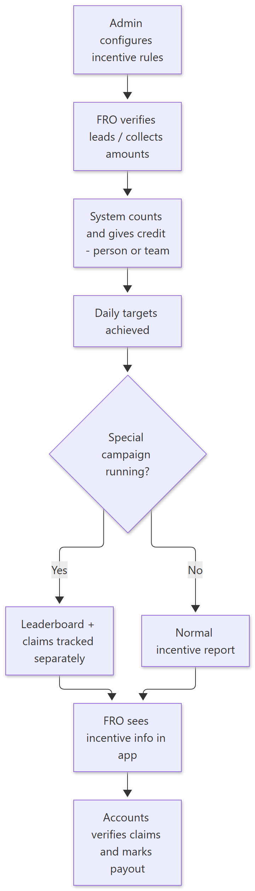
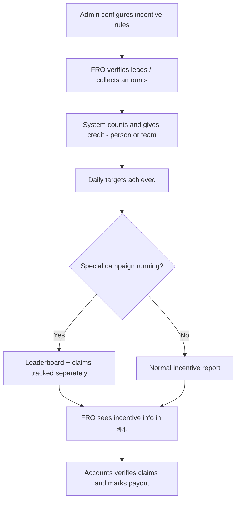

# How Incentives Work — Simple Guide

> **Document ID:** 16-Plain-English/HOW-INCENTIVES-WORK
> **Status:** Verified
> **Related:** [Accounts Panel](../03-Panel-Documentation/Accounts/PANEL.md) · [Super Admin Panel](../03-Panel-Documentation/Super-Admin/PANEL.md) · [FRO Panel](../03-Panel-Documentation/FRO/PANEL.md)

## 1. The story in one paragraph

Incentives are the extra rewards FROs earn for bringing donors and money. The admin first configures **rules** (how much a verify/donation is worth, and *who* gets credit — the FRO, the team, or the home office). Some **special incentive campaigns** (with leaderboards and claims) and **lead competitions** run on top of the normal rules. The FRO can see their own **incentive info** from their app.

## 2. Step-by-step (plain English)

1. **Configure rules** — Accounts admin sets up the incentive rules (added as AKI config / incentive setup).
2. **Targets and daily aggregation** — the system counts each eligible action (verified lead, collected amount) into daily numbers.
3. **Credit assignment** — each action earns credit for a person/team; the credit rules decide exactly who.
4. **Special campaigns** — an admin can start a special incentive (AI-drafted campaign, leaderboard, claim requests) and a lead-slab competition.
5. **FRO sees it** — field officers open their Incentive/Lead Incentive screen and see amounts and status.
6. **Verification & payout** — the Accounts team verifies incentive claims and marks payout.

## 3. Simple flowchart

Show diagram source (Mermaid)

## 4. Important rules to remember

- **Rules decide credit.** Two different configurations can give the same donor to different teams — the rules are the single source of truth.
- Special incentives are built with **AI drafts** (the system helps write campaign text) but **someone approves** before it goes live.
- **Leaderboard** and **claims** give FROs a view of ongoing competition and let them request their due.
- Incentive numbers shown to the FRO are the same numbers the admin sees — both sides look at the same records.

## 5. Key words

| Word | Meaning |
| --- | --- |
| Incentive | Extra reward for bringing donors/money |
| AKI config | The stored incentive rule set |
| Credit | Which person/team the action counts for |
| Daily aggregation | Counting the day's eligible actions |
| Special campaign | A bonus competition with leaderboard/claims |
| Lead slab competition | Contest on number/size of leads |

---
**Do not skip:** [How Donations & Receipts Work](HOW-DONATIONS-WORK.md) — incentives depend on lead verification credit.