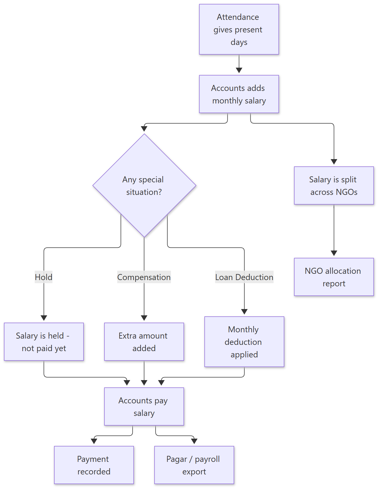
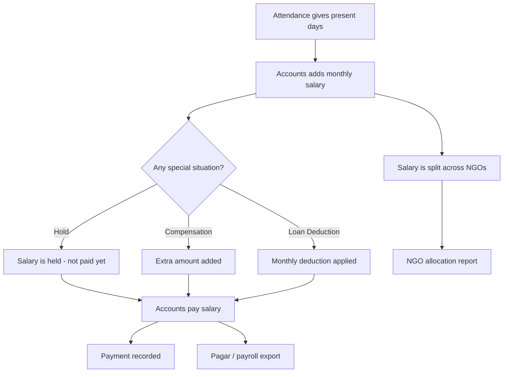

# How Payroll Works — Simple Guide

> **Document ID:** 16-Plain-English/HOW-PAYROLL-WORKS
> **Status:** Verified
> **Related:** [Accounts Panel](../03-Panel-Documentation/Accounts/PANEL.md) · [HR Panel](../03-Panel-Documentation/HR/PANEL.md) · [Technical workflow](../04-Module-Workflows/WF-PAYROLL.md)

## 1. The story in one paragraph

Every month the **Accounts team** adds a salary row for each worker. They can also put a salary **hold** (pause the payment), add **compensations** (extra amount), and see how much of the salary each **NGO** should fund (called **NGO allocation** — like splitting a restaurant bill among friends). Salary pages with personal money are locked behind a private **access code**. When everything is ready, the team **pays** the salary and can export the payroll file.

## 2. Step-by-step (plain English)

1. **Add a salary** — Accounts/HR opens Workers & Payroll → Salary and adds the monthly salary for a worker (amount comes from the attendance *present days*).
2. **Set allocations** — the system shows how the salary is split across NGOs (NGO salary allocation).
3. **Handle extras** — add a *hold* if a payment must wait, or a *compensation* for an extra amount.
4. **Pay** — clicking pay for a worker releases the salary; holds are kept apart so nothing wrong is paid.
5. **Export** — reports and the **pagar export** give the printed payroll list.
6. **Security** — anyone opening salary needs the private access code; the page refuses wrong codes.

## 3. Simple flowchart

Show diagram source (Mermaid)

## 4. Important rules to remember

- **Holds stop payment.** A held salary cannot be paid until the hold is removed.
- **Salary is private.** The page checks a 4-digit **access code**, and the frontend hides salary numbers until that code is correct.
- **NGO allocation** decides which NGO's fund pays how much of each worker — this is a report HR checks every month.
- **Loans** (advances) are repaid through monthly **deductions** from salary.

## 5. Key words

| Word | Meaning |
| --- | --- |
| Salary row | One worker's monthly salary entry |
| Hold | A pause; salary cannot be paid while on hold |
| Compensation | An extra amount on top of salary |
| NGO allocation | Share of salary funded by each NGO |
| Access code | Private 4-digit code to open salary pages |
| Pagar | The payroll/payment list export |
| Loan deduction | Monthly repayment taken from salary |

---
**Do not skip:** [How Attendance Works](HOW-ATTENDANCE-WORKS.md) — attendance creates the present days that salary uses.